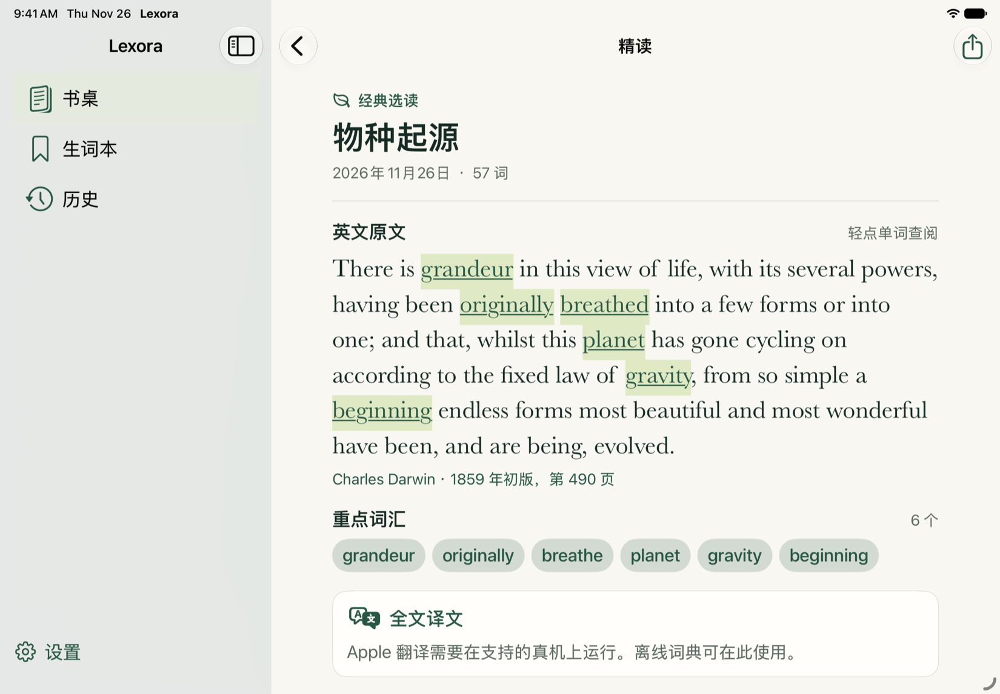

<h1></h1>

在 Lexora 里读一段英文，轻点原文中的单词，就能对照原句选释义、听英美发音，并把生词留到下次复习。应用支持英译简中，也可以离线查词。

[从源码运行](#从源码运行) · [开发日志与旧版本](CHANGELOG.md) · [发行版 0.3.0（构建 6）](https://github.com/Cooljoes/Lexora/releases/tag/v0.3.0)

## 从原文到词条

<p align="center">
  <a href="docs/images/ipad-reading.png"></a>
  <a href="docs/images/iphone-word.png"></a>
</p>

打开「书桌 → 经典选读」，就能读到图中达尔文《物种起源》的选段。读自己的文章时，可以从剪贴板粘贴英文，也可以从其他应用分享选中的文字。[查看 iPhone 书桌](docs/images/iphone-desk.png)

- **读原文**　重点词会在正文中高亮。Apple Translation 提供全文翻译，首次使用可能需要在设备上下载英译简中语言包。
- **查一个词**　点词查看语境候选释义、词形、词源和已收录的构词信息。每条音标注明来源，可分别试听英式、美式发音。
- **留着复习**　点书签收藏单词，在「生词本」查词，在「历史」继续上次的阅读。iPad 支持分栏，iPhone 使用底部标签，两端均支持大字号与深色模式。

## 从源码运行

1. 在 Mac 上克隆仓库，用 Xcode 打开工程。

   ```sh
   git clone https://github.com/Cooljoes/Lexora.git
   cd Lexora
   open Lexora.xcodeproj
   ```

2. 选择 `Lexora` 方案和 iPhone 或 iPad 模拟器，按 **⌘R**。应用支持 iOS / iPadOS 26.0 及以上，开发环境为 Xcode 27.2、Swift 6.4.2 和 iOS SDK 27.2。
3. 打开「生词本」查找 `algorithm`、`ecosystem` 或 `daylight`。公开版内置 **71,105 个有释义的英文词头**，其中 59,697 个有中文版 Wiktionary 条目。如果输入的词形没有独立词条，且词典只收录了一个对应原形，应用会打开该原形。例如输入 `telescoped`，可以查到 `telescope`。[词典来源与重建方法](docs/dictionary.md)

**装到自己的 iPhone 或 iPad**　给 `Lexora` 和 `LexoraShare` 两个 target 选择同一个开发团队，将工程级 `LEXORA_BUNDLE_ID` 改为自己的唯一标识，确认两个 target 使用相同的 App Group。连接设备，在 Xcode 里选中它，按 **⌘R**。完整的系统翻译流程需在支持的真机上验证。

**跨设备同步**　Debug 将生词和阅读历史存到当前设备。Release 使用 CloudKit 同步，需要支持 iCloud 和推送通知的开发团队，以及自己的 CloudKit 容器。

## 离线发音

默认使用设备上的系统语音。在词条中点英式或美式扬声器即可试听。要使用 **Kokoro-82M**，在工程根目录运行下列命令，再重新构建应用。

```sh
python3 Tools/fetch_voice_pack.py
```

脚本从固定版本下载 Core ML 模型和发音数据，逐项校验散列。安装后在「设置 → 单词发音」选择「AI 语音包」，即可离线使用英式 Emma 和美式 Heart。完整语音包约 95 MiB。[语音包来源与许可](KokoroVoicePack/SOURCES.txt)

## 工程、测试与许可

| 目录 | 内容 |
| --- | --- |
| [App](App) · [Core](Core) | SwiftUI 界面、NaturalLanguage 分析、Apple 翻译、SQLite 查词、SwiftData 存储和 Core ML 发音 |
| [Shared](Shared) · [ShareExtension](ShareExtension) | 主应用与系统分享扩展之间的文字收件箱 |
| [Resources](Resources) · [Tools](Tools) | 离线词典、发音资料、隐私清单、词典重建与语音包安装脚本 |
| [Tests](Tests) · [UITests](UITests) | 核心逻辑、存储、语音合成与界面测试 |

在 Xcode 中按 **⌘U** 运行测试。真实 Kokoro 合成测试需要先安装语音包。调整工程结构后，可用 XcodeGen 从 `project.yml` 重新生成工程。

每次交付 App 改动时同步更新版本号与构建号。主应用和分享扩展共用同一组编号，可在「设置 → 关于与数据来源」查看。[开发日志](CHANGELOG.md)

原创代码采用 MIT 许可。词典数据、音标和语音模型分别沿用各自的许可。[MIT 许可](LICENSE) · [第三方资料与素材](THIRD_PARTY_NOTICES.md)
