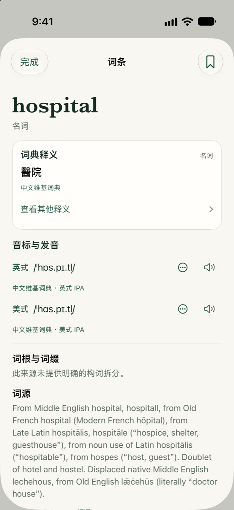
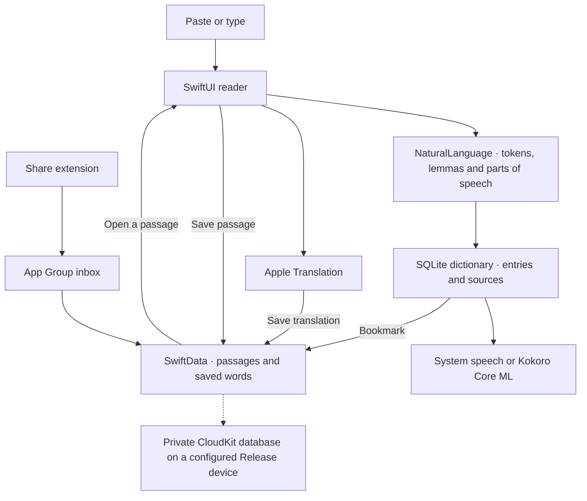

<p align="center">
  
</p>
<h1 align="center">Lexora</h1>
<p align="center"><strong>English close reading for iPhone and iPad</strong></p>
<p align="center">
  
  
  
  
</p>
<p align="center"><a href="README.md" lang="en">English</a> · <a href="README.zh-CN.md" lang="zh-CN">简体中文</a></p>

Paste an English passage or send selected text from another app. Lexora highlights words in the original, translates the passage into Simplified Chinese, and lets you compare meanings against the sentence where you found a word. The app interface is in Simplified Chinese.

**Current release · 0.3.0 (build 6).** The bundled offline dictionary covers **71,105 English headwords** with definitions. Of these, 59,697 have entries from the Chinese edition of Wiktionary. [Release](https://github.com/Cooljoes/Lexora/releases/tag/v0.3.0) · [Development log and earlier versions](CHANGELOG.md)

## Try a passage

1. Open `Lexora.xcodeproj` in Xcode. Select the **Lexora** scheme and an iPhone or iPad simulator, then press **⌘R**.
2. On the reading desk (**书桌**), open the featured selection (**经典选读**) from Darwin’s *On the Origin of Species*. Tap a highlighted word and use the bookmark to save it.
3. Open the wordbook (**生词本**) to see the saved word and sentence. Try looking up `telescoped` to find the verb `telescope`, or `hospital` to compare British and American pronunciations.

<p align="center">
  <a href="docs/images/ipad-reading.png"></a>
  <a href="docs/images/iphone-word.png"></a>
</p>

[View the iPhone reading desk](docs/images/iphone-desk.png)

## Reading features

| Area | What you can do |
| --- | --- |
| Reading | Paste or type a passage, or send selected text through the share sheet. Read with Dynamic Type, Dark Mode and a sidebar on iPad. |
| Translation | Read the full Simplified Chinese translation alongside the English original. On a supported device, Apple Translation may prompt you to download the language pair on first use. |
| Dictionary | Look up a word offline. Meanings are ranked using part of speech and sentence context. Entries show available IPA, word formation and etymology with their sources. An exact spelling takes priority when a form has multiple interpretations. |
| Pronunciation | Listen to British and American system voices, or install the optional Kokoro-82M pack for on-device synthesis. |
| Library | Save a word with its sense and original sentence, or reopen a passage from reading history. A configured Release build can sync the library across devices with CloudKit. |

## Architecture



<details>
<summary>Source tree</summary>

| Directory | Contents |
| --- | --- |
| [App](App) · [Core](Core) | SwiftUI screens, text analysis, translation, dictionary lookup, persistence and speech |
| [Shared](Shared) · [ShareExtension](ShareExtension) | Text validation and the shared inbox used by the app and extension |
| [Resources](Resources) · [Tools](Tools) | Bundled dictionary, privacy manifest, data importers and voice-pack installer |
| [Tests](Tests) · [UITests](UITests) | Unit tests and interface tests |

</details>

## Build and test

The deployment target is **iOS / iPadOS 26.0**. Release 0.3.0 was built with Xcode 27.2, Swift 6.4.2 and the iOS 27.2 SDK. The Xcode project is checked in. XcodeGen is optional when regenerating it from `project.yml`.

```sh
git clone https://github.com/Cooljoes/Lexora.git
cd Lexora
open Lexora.xcodeproj
```

Choose a simulator and press **⌘U** to run the tests. Use a supported iPhone or iPad to test the full Apple Translation flow, including the first language-pack download.

**On your own device.** In Signing & Capabilities, select the same development team for `Lexora` and `LexoraShare`. Set the project’s `LEXORA_BUNDLE_ID` to a unique identifier and configure the same App Group for both targets. Select the connected device and press **⌘R**. Debug builds use local storage. For Release sync, set up your own CloudKit container and use a team with iCloud and push notification entitlements.

**Optional Kokoro voices.** Run the following command from the repository root, then rebuild. The installer verifies the pinned assets. In **设置 → 单词发音**, choose **AI 语音包** for Emma (British) and Heart (American). The installed pack occupies about 95 MiB and enables the real synthesis test. [Voice-pack sources and licenses](KokoroVoicePack/SOURCES.txt)

```sh
python3 Tools/fetch_voice_pack.py
```

## Data and privacy

Definitions and etymologies come from the English and Chinese editions of Wiktionary via Kaikki. Lexora preserves the source language and links to the entry. Britfone supplies additional British pronunciations, and Lexora transcribes CMUdict’s American pronunciations from ARPAbet into broad IPA. [Dictionary coverage and rebuild instructions](docs/dictionary.md) · [Pronunciation sources and conventions](Resources/Pronunciation-Licenses.txt)

Lexora reads the clipboard when you tap a paste control. Dictionary lookup and word pronunciation run on the device. Debug builds and simulators store your library locally. A configured Release build on a device syncs passages, translations, saved words and their sentences through the reader’s private iCloud database. The app has no advertising or analytics SDK. [Privacy manifest](Resources/PrivacyInfo.xcprivacy)

## Contributing and licensing

For a dictionary correction, include the spelling, the sentence that changes its meaning and a link to the source entry. For an app issue, include the app version, device and steps to reproduce it. [Report an issue](https://github.com/Cooljoes/Lexora/issues)

When changing the app, update the version and build number shared by the app and its extension and record the change in the development log. Both numbers are visible in **设置 → 关于与数据来源**. [Development log](CHANGELOG.md)

Original Lexora code is available under the MIT license. The dictionary data, pronunciation references and optional voice assets retain their upstream terms. [MIT license](LICENSE) · [Third-party notices](THIRD_PARTY_NOTICES.md)
