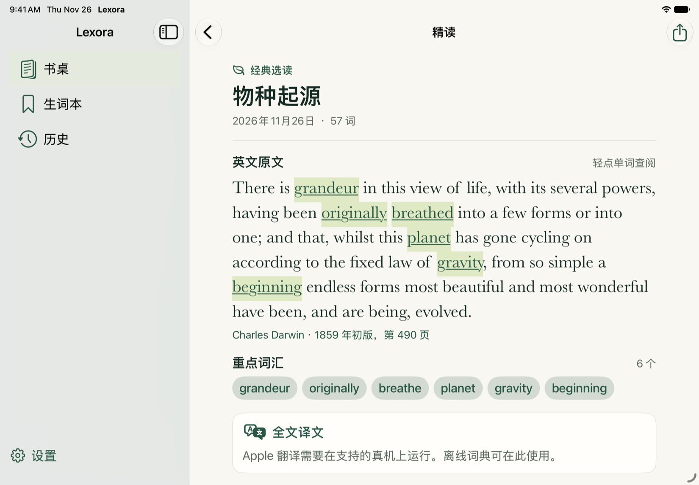
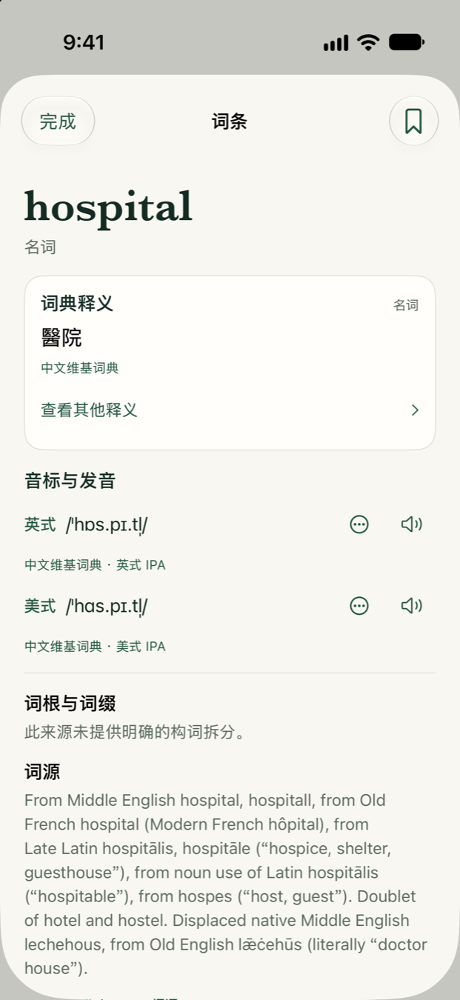
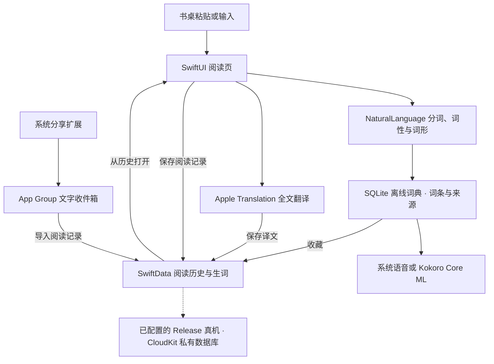

<p align="center">
  
</p>
<h1 align="center">Lexora</h1>
<p align="center"><strong>iPhone 与 iPad 上的英语精读</strong></p>
<p align="center">
  
  
  
  
</p>
<p align="center"><a href="README.md" lang="en">English</a> · <a href="README.zh-CN.md" lang="zh-CN">简体中文</a></p>

粘贴一段英文，就能边读边查。轻点原文里的词，对照上下文挑选释义、听英美发音，再连同原句收入生词本。需要通读整段时，可以在原文下方查看简体中文译文。

**当前版本 0.3.0（构建 6）** · 公开版内置 71,105 个有释义的英文词头，其中 59,697 个收录了中文版维基词典的条目。词库随应用安装，断网也能查阅。[GitHub 发行版](https://github.com/Cooljoes/Lexora/releases/tag/v0.3.0) · [开发日志与旧版本](CHANGELOG.md)

## 试读一段英文

1. 在 Mac 上用 Xcode 打开 `Lexora.xcodeproj`，选择 **Lexora** 方案和 iPhone 或 iPad 模拟器，按 **⌘R**。
2. 在「书桌 → 经典选读」打开达尔文《物种起源》的选段。轻点原文中的 `endless`，查看释义和词源，再点英式、美式扬声器试听。
3. 在词条右上角点书签收藏，回到「生词本」查看。也可以在搜索框输入 `telescoped`，点「查词」打开原形 `telescope` 的动词释义。

<p align="center">
  <a href="docs/images/ipad-reading.png"></a>
  <a href="docs/images/iphone-word.png"></a>
</p>

读自己的文章时，在书桌点「粘贴英文」，也可以从其他应用的系统分享菜单发送选中的文字。[查看 iPhone 书桌](docs/images/iphone-desk.png)

## 阅读与查词

| 功能 | 使用方式 |
| --- | --- |
| 原文与翻译 | NaturalLanguage 分词、识别词性并还原词形，阅读页高亮重点词。支持的真机会调用 Apple Translation 翻译全文，首次使用可能提示下载英译简中语言包。 |
| 离线词条 | 轻点单词，根据原句比较候选释义。词条标出资料来源，并展示已收录的音标、词源和构词信息。生词本优先查输入的拼写，只有一个对应原形且原拼写缺少独立词条时才打开原形。 |
| 单词发音 | 默认使用设备上的英语系统语音，英式和美式可分别选声。也可在安装 Kokoro-82M 后切换到离线 AI 发音。 |
| 收藏与历史 | 生词本保存选中的释义和原句，历史记录可重开读过的文章。iPad 使用分栏，iPhone 使用底部标签，两端均支持大字号与深色模式。 |

## 系统架构



<details>
<summary>查看工程目录</summary>

| 目录 | 内容 |
| --- | --- |
| [App](App) · [Core](Core) | 书桌、阅读页、生词本、文本分析、词典查询、语音和资料库存储 |
| [Shared](Shared) · [ShareExtension](ShareExtension) | 主应用与分享扩展共用的文字收件箱 |
| [Resources](Resources) · [Tools](Tools) | 离线词典、许可、隐私清单、词库重建和语音包安装脚本 |
| [Tests](Tests) · [UITests](UITests) | 核心逻辑、持久化、语音合成和界面测试 |

</details>

## 构建与测试

应用支持 iOS 和 iPadOS 26.0 及以上。0.3.0 使用 Xcode 27.2、Swift 6.4.2 和 iOS SDK 27.2 构建。仓库内已包含 Xcode 工程。

```sh
git clone https://github.com/Cooljoes/Lexora.git
cd Lexora
open Lexora.xcodeproj
```

选择 **Lexora** 方案，按 **⌘R** 运行，按 **⌘U** 测试。调整工程结构时，可用 XcodeGen 根据 `project.yml` 重新生成工程。

**安装到自己的设备**　将工程级 `LEXORA_BUNDLE_ID` 改为自己的唯一标识。为 `Lexora` 和 `LexoraShare` 选择同一开发团队，并为两个 target 配置相同的 App Group。连接 iPhone 或 iPad，在 Xcode 里选中设备，按 **⌘R**。完整的英译简中流程需在支持的真机上验证。

**启用 Kokoro 离线语音**　在工程根目录运行以下命令，再重新构建应用。脚本从固定版本下载模型与发音数据并校验散列，完整语音包约 95 MiB。实际合成测试也使用这份语音包。

```sh
python3 Tools/fetch_voice_pack.py
```

安装后，打开「设置 → 单词发音 → AI 语音包」，即可离线使用英式 Emma 和美式 Heart。[语音包来源与许可](KokoroVoicePack/SOURCES.txt)

## 数据来源与隐私

释义、词源及词条音标取自中英文维基词典，由 Kaikki 使用 Wiktextract 提取。Britfone 补充英式读音，CMUdict 补充美式读音，其音素按工程内的映射转写为宽式 IPA。可在词条中查看相应来源。[词库覆盖与重建](docs/dictionary.md) · [发音资料与转写规则](Resources/Pronunciation-Licenses.txt)

应用仅在点按粘贴按钮时读取剪贴板。Debug 和模拟器将原文、译文、阅读历史和收藏保存在本机。Release 真机配置 iCloud、推送权限及自己的 CloudKit 容器后，可通过用户的私有数据库同步。应用不含广告或统计 SDK。[隐私清单](Resources/PrivacyInfo.xcprivacy)

## 贡献与许可

反馈词条问题时，请附上单词、能重现该义项的例句和界面显示的数据来源。反馈发音问题时，请注明英式或美式、所用语音及系统版本。[提交反馈](https://github.com/Cooljoes/Lexora/issues)

提交应用改动时，请更新主应用与分享扩展共用的版本号和构建号，并在开发日志中记录变化。两项编号均可在「设置 → 关于与数据来源」查看。[开发日志](CHANGELOG.md)

Lexora 原创代码使用 MIT 许可。词典内容、参考音标和可选语音包沿用各自的许可。[MIT 许可](LICENSE) · [第三方资料与素材](THIRD_PARTY_NOTICES.md)
